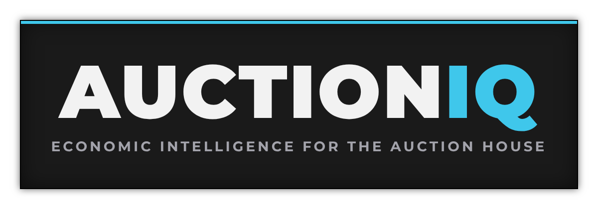

  

<b>Economic intelligence for the Auction House.</b> 
AuctionIQ helps you decide what to do, then keeps the books on what actually happened.

  
  
  
  

A World of Warcraft addon that puts crafting and auction advice in one place: what to craft, buy,
post and cancel, what it costs, and what it really sells for. It reads prices from TradeSkillMaster
and Oribos Exchange, checks them against what the Auction House actually shows you, and over time
makes you a better goblin.

---

## Features

- **One window, four tabs**: everything a gold-maker needs, from the first scan to the final tally
- **Know what's worth crafting**: every recipe ranked by profit, Concentration included
- **Compare reagent costs**: the advisor looks for the cheapest mix for each quality
- **Work orders worth taking**: commission, rewards and knowledge points at a glance
- **A plan for every knowledge point**, drawn right on your profession trees
- **Plan crafting, shopping, auctions and mail** across your warband
- **Compare price sources**: your own AH scans side by side with TSM and Oribos Exchange
- **Track sales, costs and estimated profit**, with 7, 30 and 90 day reports

| | |
|---|---|
|  **Dashboard** | What needs you right now |
|  **Research** | What's worth doing |
|  **Operations** | Getting it done |
|  **Accounting** | What actually happened |

## AddOns

AuctionIQ loads on its own. Install [TradeSkillMaster](https://www.curseforge.com/wow/addons/tradeskill-master)
for pricing and sales history; [Oribos Exchange](https://www.curseforge.com/wow/addons/oribos-exchange) is optional.

## Install

1. Download the zip from [Releases](https://github.com/Courtizy/AuctionIQ/releases), or for now
   **Code > Download ZIP** on this page.
2. Unzip it into `World of Warcraft\_retail_\Interface\AddOns` and make sure the folder is named
   `AuctionIQ` (rename `AuctionIQ-main` if that's what you got).
3. Log in and open each profession window once, so AuctionIQ learns your recipes.
4. Type `/aiq` to open AuctionIQ. For crafting, open a profession and type `/aiq scan` to get started.

## Chat Commands

`/aiq` - open or close the window 
`/aiq dashboard`, `research`, `operations`, `accounting` - open a tab 
`/aiq advisor` - crafting advisor on or off 
`/aiq queue` - craft queue and shopping list 
`/aiq scan` - rank every recipe of the open profession 
`/aiq plan <goal>` - knowledge point plan, e.g. `/aiq plan potions` 
`/aiq minimap` - hide or show the minimap button

## Roadmap

See the [milestones](https://github.com/Courtizy/AuctionIQ/milestones).

## Development

Code layout, tests and releases

Plain Lua, no libraries. One folder per tab (`Dashboard`, `Research`, `Operations`, `Accounting`),
plus `Core` and `Data` underneath them. The look is described in [THEME.md](THEME.md).

**Tests:** `python3 tests/run_tests.py` (needs `pip install lupa`) runs the addon in a stubbed WoW
environment, on every pull request.

**Releases:** tagging `v*` builds a release with the BigWigs packager.

## License

MIT. See [LICENSE](LICENSE).
