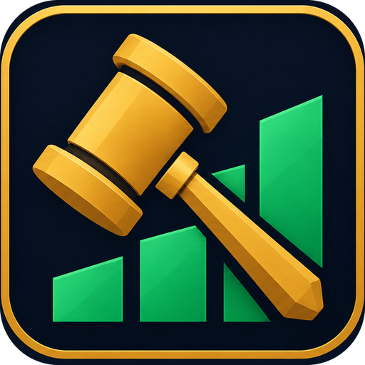

  

<h1 align="center">AuctionIQ</h1>

<b>Economic intelligence for the Auction House.</b> 
AuctionIQ helps you decide what to do. Clearinghouse, its ledger, tells you what actually happened.

  
  
  
  

A World of Warcraft addon that puts crafting and auction advice in one place: what to craft, buy,
post and cancel, what it costs, and what it really sells for. It reads prices from TradeSkillMaster
and Oribos Exchange, checks them against what the Auction House actually shows you, and over time
takes over the jobs that today need both TSM and CraftSim.

---

## Features

- One window, six tabs: Today, Markets, Crafting, Trading, Analytics and Clearinghouse
- Tooltips on every item: the value after the 5% cut, the price to buy it, and the profit of crafting it
- A crafting advisor that works out profit the way CraftSim does, Concentration included
- Work orders and first crafts priced up, with the ones that give a knowledge point marked 1KP
- Every learned recipe ranked by profit, gold per Concentration point, or gold a day
- Knowledge point plans drawn on the profession's own trees
- A craft queue, with a shopping list priced by walking the AH listings
- Prices compared three ways: your AH scans, TSM and Oribos Exchange
- Stock targets, dead stock and gold per hour
- A full ledger of sales, purchases, failed auctions and profit by product, with CSV export
- …and more!

## Required AddOns

- [TradeSkillMaster](https://www.curseforge.com/wow/addons/tradeskill-master): prices and accounting. Without it, AuctionIQ still tracks gold and Concentration.

## Supported AddOns

- [Oribos Exchange](https://www.curseforge.com/wow/addons/oribos-exchange): a second opinion on realm and region prices in Compare prices and the tooltip.

## Installation

1. Download the zip: from [Releases](https://github.com/Courtizy/AuctionIQ/releases) once there is one,
   or for now **Code > Download ZIP** on this page.
2. Unzip it into `World of Warcraft\_retail_\Interface\AddOns` and name the folder `AuctionIQ`
   (a Download ZIP folder is called `AuctionIQ-main`; rename it).
3. Install TradeSkillMaster if you don't have it.
4. Log in and open each profession window once, so AuctionIQ learns your recipes.
5. Type `/aiq` to open the window.

<b>Moving from Clearinghouse</b> (the addon's old name)

Install the AuctionIQ folder and keep the old Clearinghouse folder for one login with only the stub
`migration/Clearinghouse.toc` in it. AuctionIQ copies the old saved data over on first login and says
so. After that, delete the Clearinghouse folder.

---

## The window

| Tab | What it answers |
|-----|-----------------|
| **Today** | Where to focus now: the gold chart and a ranked **Do next** list (full Concentration, ready cooldowns, post-now windows, mail, restock, below stock target, reposts). Click a card to go where the work is. |
| **Markets** | Compare prices (your AH scans against TSM and Oribos Exchange), market prices, competition, when items sell. |
| **Crafting** | Concentration, best crafts, buy instead of craft, the weekly knowledge plan, and Scan, Paths, Queue, Results and the advisor. |
| **Trading** | Groups, operations and mail routes (also set from the mailbox's Routes button). |
| **Analytics** | Stock targets (a week of demand at a 90% service level, both settable), dead stock, gold per hour. |
| **Clearinghouse** | The books: the Report (7/30/90 days and the daily rundown), inventory, revenue, expenses, failed auctions (with the deposits they cost), profit by product, holdings, overhead, CSV export. |

Open it with `/aiq`, the minimap button or the addon compartment. The crafting tools (Advisor, Scan,
Paths, Queue, Results) dock to the right of the profession window. Drag them off to float them, and
Dock on the tab row puts them back. Only one shows at a time, and the queue can pop out to stay
under them while you work.

## Crafting

<b>Crafting advisor</b>: every result quality, its cheapest reagents and its profit

For the selected recipe, every result quality with its cheapest reagents, the profit, and with
Concentration the cost in points and the gold each point earns. It marks the best profit and the
best use of Concentration, worked out the same way CraftSim does:

- profit is the average per craft, counting Multicraft's extra items and the reagents
  Resourcefulness saves
- an item is valued at what you can expect to get for it: the price after the cut, less the
  deposits you'll lose to expiries before it sells and the cost of gold tied up meanwhile (1% a
  day by default). How often it sells starts from the region's sale rate and moves toward your
  own record as you post
- Concentration's cost counts Ingenuity refunds, with your specialization's bonuses to them
- finishing reagents: every combination is tried and the best is used, with whether to use the
  ones you have or buy them
- crafting orders (commission and patron rewards against your reagents, the customer's minimum
  quality) and recrafts (the better item less the one you have)
- top gear: whether another profession tool or accessory in your bags would earn more, with an
  Equip button
- Simulate: see the numbers with more skill, or with a knowledge point plan from Paths

<b>Recipe scan, work orders and first crafts</b>

`/aiq scan`, or the Scan tab. Click any column header to sort by it, and again to flip.

- **Recipes**: every learned recipe ranked by profit per craft, gold per Concentration point, or
  gold a day (profit times what the region sells, up to your daily cap).
- **Work orders**: every order the game has shown you (search Patron and Personal on the Crafting
  Orders tab first) with the commission after the consortium's cut, the rewards (valued after the
  cut when they sell), the reagents you'd supply and the profit. Orders whose reward gives a
  knowledge point are marked **1KP**.
- **First crafts**: recipes that still give their first-craft knowledge point, at their cheapest
  reagents, with what the point costs you after selling what it makes.

Click a row to open it, shift-click to queue it. Queue all queues every order that pays or gives
knowledge, or every first craft.

<b>Profession paths</b>: a knowledge point plan for what you want to sell

`/aiq plan potions`, or the Paths tab. Type what you want to sell and get a plan for the open
profession, node by node, with the gold a day each step adds and which recipes it improves. The plan
is drawn on the profession's own trees in the Paths tab, and marked with step badges on the game's
Specializations tab. All eight crafting professions, from Blizzard's own game data. Each profession
has its own goal groups (Enchants, Gems, Garments, Weapons...), and Enchanting has a
**Disenchanting** goal: it plans the Disenchanting tree for a bigger share of rank 2 dust, shards and
crystals, from what you disenchant a day (`/aiq de 40 8 2`).

<b>Craft queue and shopping list</b>

`/aiq queue`, or Queue on the advisor. Click an advisor row to queue one, shift-click to queue as
many as you can make. Fill queues the open profession's five best crafts. Craft makes the queued
crafts with the advisor's reagents and Concentration, and finished crafts come off the queue.

The shopping list totals the reagents for the whole warband's queue against what you have, and
prices what's left by walking the listings: buying 200 of a reagent costs what the cheapest 200
listed cost, not 200 times the cheapest one. It uses your AH search from the last 15 minutes, else
the last AH scan saved for that item, else `chmat`. Hover a cost to see how far above the cheapest
listing it is.

<b>Craft results and cooldowns</b>

`/aiq results` shows what your crafts really gave (Multicraft, Resourcefulness, Ingenuity) against
what the advisor expected. Cooldowns across the warband are in the report.

## Markets

- **Compare prices**: every item you hold, sold this month, need for the queue or searched at the
  AH today, priced three ways side by side: your last AH scan (Blizzard's live data, saved whenever
  you, AuctionIQ or TSM search the AH), TSM's realm value and Oribos Exchange's. Gap is the scan
  against the other two. 15% under reads *cheap now*, 15% over reads *pricey now*, and TSM and
  Oribos more than 25% apart reads *disagree*. Region averages are shown for reference.
- **Market prices**: now, the 7-day average, the trend and listings for what you hold or sold.
- **Competition**: who undercuts you and how often, from your post scans.
- **When it sells**: the day and hours your sales cluster in, and when to post by.

## Clearinghouse, the ledger

The books: sales, purchases, income, expenses, expired and cancelled auctions (with the deposits
each one cost), inventory, and the Goblin CFO views (profit by product, holdings, overhead). It reads
TradeSkillMaster's accounting and never writes to it.

The **Report** opens with the last 7, 30 and 90 days side by side (sales after the cut, purchases,
overhead, cash profit, net worth change), the top sellers and crafted profit by product line, then
the daily rundown (last 24 hours, mail, what to post, restock, cooldowns). `/aiq report` opens it.
**Export** turns the table you're looking at, with its filters, into CSV text to copy out.

## Prices

Two prices, the same everywhere:

| Name | Means | TSM formula |
|---|---|---|
| `chmat` | what a reagent costs to buy today | `max(first(dbminbuyout,dbmarket,dbregionmarketavg),80%first(dbmarket,dbregionmarketavg))` |
| `chvalue` | what a crafted item sells for | `min(chmat, max(first(dbregionsaleavg,dbregionmarketavg),min(dbmarket,400%first(dbregionsaleavg,dbregionmarketavg))))` |

Add them to TSM as custom sources (`/tsm` > Settings > Custom Sources) to use them in your own
operations. If you don't, AuctionIQ passes the formulas to TSM itself, so the numbers match. Craft
cost is TSM's own `crafting` price.

## Chat Commands

`/aiq` (or `/ch`) - open or close the main window 
`/aiq today`, `markets`, `crafting`, `trading`, `analytics`, `ledger` - open a tab 
`/aiq report` - open the Report 
`/aiq advisor` - crafting advisor on or off 
`/aiq queue` - craft queue and shopping list 
`/aiq scan` - rank every recipe of the open profession 
`/aiq plan <goal>` - knowledge point plan, e.g. `/aiq plan potions` 
`/aiq results` - what your crafts really gave 
`/aiq cap <n>` - most of one item you'd sell a day, for gold a day _(default 10)_ 
`/aiq de <dust> <shards> <crystals>` - what you disenchant a day, for Disenchanting plans _(default 40 8 2)_ 
`/aiq tooltip` - tooltip lines on or off 
`/aiq coins` - coin icons or g/s/c text 
`/aiq minimap` - hide or show the minimap button

---

## Roadmap

The plan lives in [GitHub milestones](https://github.com/Courtizy/AuctionIQ/milestones), one per phase
(Phase 0: prove what's built, through Phase 5: release), with an issue per item labelled by component.

## Development

Plain Lua, no libraries.

### Tests

`python3 tests/run_tests.py` (needs `pip install lupa`) loads the addon in a stubbed WoW environment
and checks prices, tooltips, profession tracking, the views and the layout. It runs on every pull
request.

### Releases

Tagging `v*` builds a release with the BigWigs packager.

### Code layout

One folder per component, each with its own `comp:` label on GitHub:

| Folder | What it owns |
| --- | --- |
| `Core/` | Start-up, settings, theme, window, tab bar, minimap button, tooltips, alerts |
| `Data/` | Price sources, AH scans, order book, TSM-syntax formulas, the sales ledger, item stats |
| `Today/` | The opening page: what to do next |
| `Crafting/` | Scan, advisor, paths, specs (`Crafting/Specs/`), queue, planner, professions, gear, cooldowns, orders, craft log |
| `Trading/` | Groups and operations, posting and cancelling, mail |
| `Analytics/` | Stock targets; forecast vs actual lands here |
| `Clearinghouse/` | The ledger tab and reports |
| `Markets/` | The Markets tab: compare prices, market prices, competition, when it sells |

`AuctionIQ.toc` sets the load order: Core and Data first, then the components that use them. The
look is described in [THEME.md](THEME.md).

## License

MIT. See [LICENSE](LICENSE).
